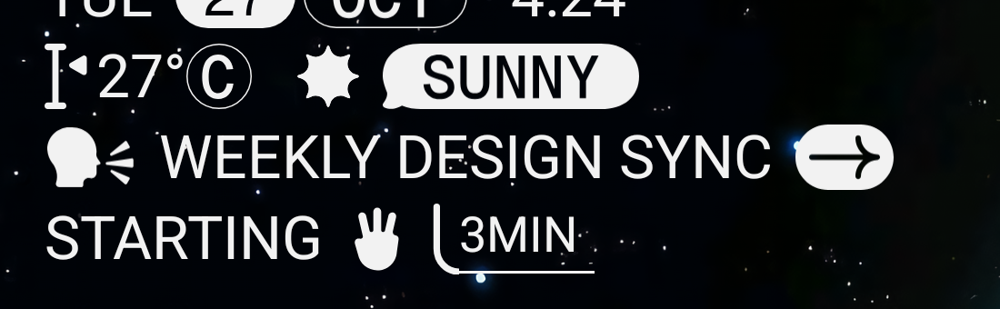

# Micrographics widget

Two home screen widgets for Android (built for the Pixel Launcher) that recreate Nothing OS 4
lock screen clocks.

**Micrographics clock**

```
FRI (25)(JUL)  10:27
I< 23°(C)  * (SUNNY)
(avatar) WEEKLY DESIGN SYNC (->)
STARTING (hand) ╰3MIN
```



**Gooey clock**: the time as four big rounded digits ("1020"), scaled to fill the widget.

The icons, month pills, weather labels and Gooey digits are Nothing's own vector drawables,
decoded from Nothing OS `SystemUI.apk`. They belong to Nothing Technology and are included for
personal use only; this repository is private for that reason. The Micrographics text font is
Geist Mono (SIL Open Font License) at weight 400, with its standard slashed zero; the Gooey font
(`gooey_clock.ttf`) was built from Nothing's `gooey_0`–`gooey_9` drawables.

Launchers draw widget text with system fonts only, so both widgets render their text to
bitmaps in the app and redraw once a minute.

## Install

Download `Micrographics.apk` from the latest release, plug in the phone with USB debugging on,
then:

    adb install -r Micrographics.apk

Open **Micrographics**, grant calendar and location access (or type a city for weather), then
tap **Add widget to home screen** or **Add Gooey clock to home screen**. You can also
long-press the home screen, tap **Widgets** and add **Micrographics clock** or **Gooey clock**.
Needs Android 12 or newer.

## How it updates

- A minute alarm redraws both widgets at the start of every minute. It doesn't wake the
  phone: while the screen is off it waits, then fires as soon as the screen comes on.
- Weather comes from Open-Meteo (no API key), refreshed every 30 minutes for the location
  set in the app. Tap the weather row to change it or switch to °F.
- The next timed calendar event in the next 12 hours shows on rows 3 and 4. Within an hour of
  it starting, the countdown updates every minute; for the last 10 minutes a hand icon counts
  down too. Once it starts the row shows when it ends. Calendar edits show up within about
  15 seconds.

## Build

Needs JDK 17 and the Android SDK (platform 35). Set `sdk.dir` in `local.properties`, then:

    ./gradlew assembleRelease

Release builds are signed with the local debug key, since the app is only sideloaded.
